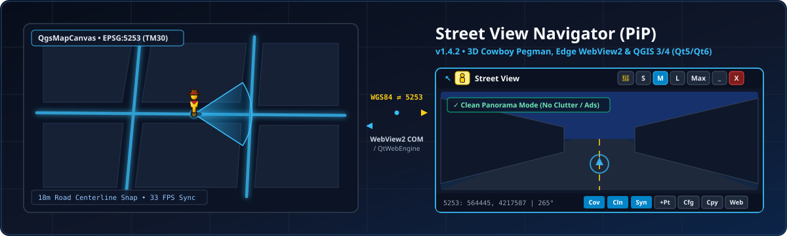
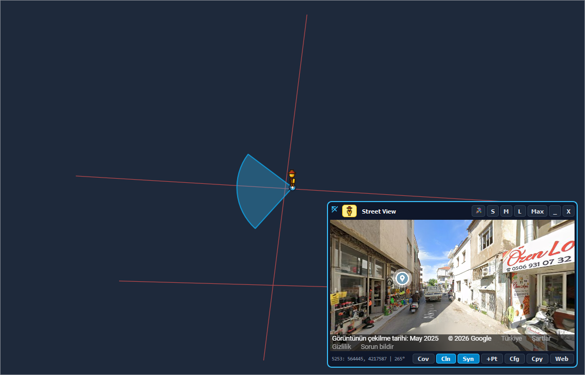
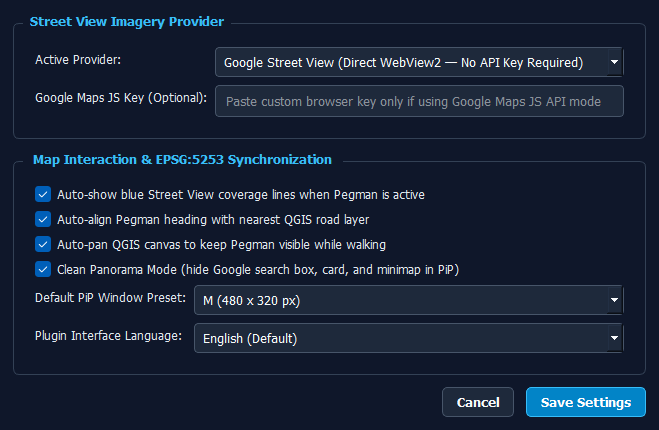

<div align="center">



<br/>

# 🤠 Street View Navigator (PiP) (`v1.4.2`)
### *Interactive Cowboy Pegman Drag-and-Drop, Resizable Bottom-Right Picture-in-Picture (PiP) Street View Browser & Live `EPSG:5253` Sync for QGIS 3 & QGIS 4*

[](https://plugins.qgis.org/)
[](https://www.qt.io/)
[-10b981?style=for-the-badge)](https://epsg.io/5253)
[](https://developer.microsoft.com/en-us/microsoft-edge/webview2/)
[%20%7C%20TR-ea580c?style=for-the-badge)](#%EF%B8%8F-settings--multilingual-ui)
[](LICENSE)

[](https://doi.org/10.1007/s00190-012-0578-z)
[](https://doi.org/10.1109/MC.2010.170)
[](https://doi.org/10.1016/j.landurbplan.2021.104217)

**Author / Developer:** [Baran Adsuna](https://github.com/baranadsuna) • Dokuz Eylül University, Department of Urban and Regional Planning  
**Documentation Portal:** [https://baranadsuna.github.io/street_view_pip](https://baranadsuna.github.io/street_view_pip) • **Releases:** [Download `v1.4.2` (.zip)](https://github.com/baranadsuna/street_view_pip/releases/latest)

</div>

---

## 🌟 Why Street View Navigator (PiP)?

Working inside QGIS with satellite basemaps (`Google Satellite`, orthophotos) or CAD/zoning vectors often raises a simple field question: ***"What does this street or building facade actually look like on the ground right now?"***

Switching out to a separate browser window breaks spatial focus and forces manual coordinate copying. **Street View Navigator (PiP)** embeds real, interactive **360° Google Street View** (plus optional Google Maps JS API or open-source Panoramax) directly inside a **corner-anchored, resizable Picture-in-Picture (PiP) overlay** on `QgsMapCanvas` — with full two-way Pegman & Field-of-View cone synchronization in `EPSG:5253`.

---

## ✨ Key Features

1. **🤠 Single-Button Toggle & One-Shot Cowboy Pegman (`PegmanMapTool`)**:
   - Click the single yellow **Cowboy Pegman** icon on the QGIS toolbar once to activate **blue Google Street View coverage lines** (`mts2.google.com/mapslt?lyrs=svv`) and arm a **one-shot drop tool**.
   - **Single-click** (or **click + drag** to aim your heading) anywhere on a street: Pegman snaps onto the nearest loaded QGIS road centerline (`<= 18 m` metric `EPSG:5253`), launches Street View in the bottom-right PiP corner, and **automatically returns QGIS to your normal Pan/Select cursor**.
   - Click the toolbar icon a second time (or click **`X`** on the PiP header) to hide the PiP window, Pegman, FOV cone, and coverage overlay cleanly.

2. **🖐️ Direct On-Canvas Grab-and-Drop (`CanvasPegmanDropFilter`)**:
   - Hover the yellow Pegman directly on your QGIS map (`OpenHandCursor`), click to **grab him by his raised hand/collar** (hand teleports to your cursor tip with pendulum tilt and a blue drop reticle **`34 px`** below his boots), and drop him onto any new street!
   - Or drag the yellow Pegman button straight out of the PiP header onto `QgsMapCanvas`.

3. **🏃 Distance-Aware Locomotion & 🎉 Johnny Bravo Confetti Mode (`CanvasPoseOverlay`)**:
   - Smooth **33 FPS** animation loop synchronized with live Street View movement:
     - **Walks** naturally for short along-street steps (`<= 28 m`).
     - **Sprints / Runs** with forward lean and speed trails for larger map jumps (`> 28 m`).
     - **Turns head & torso** toward your panning azimuth and **waves after 30 seconds** idle.
     - Click the **🎉 Party Confetti button** in the PiP header to toggle **Johnny Bravo's "Do the Monkey!"** celebration dance with floating confetti ribbons.

4. **🪟 Corner-Anchored Resizable Picture-in-Picture (PiP)**:
   - Anchored neatly in the bottom-right corner of `QgsMapCanvas` (`14 px` margin); tracks canvas resizes automatically.
   - Smoothly resize via the **`↖` top-left corner grip** or window edges while keeping the bottom-right corner pinned.
   - Header controls: **`🎉` Dance**, **`S / M / L / Max`** quick presets, **`BR`** snap back to corner (shown if dragged free), **`_`** collapse into a tiny bottom-right Pegman pill, **`X`** close session.

5. **🧼 Pure Street View Panorama Mode (`EARLY_CLEAN_DOCUMENT_JS`)**:
   - Suppresses Google Chrome promo modals, Sign-in/Apps clutter, Place/Reviews drawers (`#QA0Szd`, `.XltNde`), tooltips, search box, minimap, and logo overlays so compact PiP sizes remain 100% unobstructed panorama views.
   - Includes an **Anti-Place-Hijack Guard** that reverts accidental shop/POI card clicks (`/maps/place/...`) back to the active Street View panorama.

6. **🚀 Zero Black-Screen Native Edge WebView2 (`WebView2HostWidget`)**:
   - Uses Microsoft Edge WebView2 COM (`WebView2Loader.dll`) directly on Windows (**both QGIS 3 Qt5 and QGIS 4 Qt6**) and `QWebEngineView` on Linux/macOS/Qt6 builds, with a clean offscreen fallback card for headless CI.
   - Preserves WebView2's native User-Agent & `Sec-CH-UA` Client-Hints while configuring a dark slate `#0f172a` `ICoreWebView2Controller2` background — preventing blank/black WebGL initialization screens on fresh machines.

7. **📍 1-Click `EPSG:5253` Field Observation Logger (`observation_logger.py`)**:
   - Press **`+Pt`** to append the active Street View pose (`obs_id`, `timestamp`, `epsg5253_x`, `epsg5253_y`, `lat_wgs84`, `lon_wgs84`, `heading_deg`, `pitch_deg`, `fov_deg`, `pano_id`, `sv_url`, `field_note`) directly into an `EPSG:5253` memory point layer (`StreetView_Observations_EPSG5253`) styled with directional rotated arrowhead markers (`QgsSymbolLayer.Property.PropertyAngle`).

---

## 🖥️ Real PyQGIS GUI & Controls

<div align="center">

<table>
<tr>
<td width="54%" align="center">

<br/>
<sub><b>Figure 1:</b> Live PyQGIS <code>QgsMapCanvas</code> in <code>EPSG:5253</code> with Cowboy Pegman, geodesic FOV viewing cone, and bottom-right Edge WebView2 Street View PiP over Akyol Cd. (Tire, İzmir).</sub>
</td>
<td width="46%" align="center">

<br/>
<sub><b>Figure 2:</b> <code>StreetViewSettingsDialog</code> (<code>v1.4.2</code>) supporting zero-key Google Street View Direct, optional Google Maps JS API mode, open-source Panoramax, road snapping, Clean Mode, and EN/TR switching.</sub>
</td>
</tr>
</table>

</div>

### PiP Footer & Header Quick Reference

| Control | Location | Action |
| :---: | :---: | :--- |
| **`🎉`** | Header | Toggle **Johnny Bravo "Do the Monkey!"** dance + confetti on Pegman |
| **`S / M / L / Max`** | Header | Resize PiP to Small (`390×260`), Medium (`480×320`), Large (`680×450`), or Full Canvas |
| **`_`** | Header | Collapse PiP into a compact bottom-right Pegman pill (`30 px` height) |
| **`X`** | Header | End Street View session and clear Pegman, FOV cone, coverage lines, and PiP |
| **`Cov`** | Footer | Toggle blue Google Street View coverage lines (`SVV Overlay`) on QGIS canvas |
| **`Cln`** | Footer | Toggle **Clean Panorama Mode** (hide/restore Google Maps UI overlays inside PiP) |
| **`Syn`** | Footer | Auto-pan QGIS canvas while walking along streets inside Street View |
| **`+Pt`** | Footer | Log active panorama pose into `StreetView_Observations_EPSG5253` layer |
| **`Cfg`** | Footer | Open plugin Settings (Provider, Auto-Coverage, Road Snap, Presets, EN/TR) |
| **`Cpy`** | Footer | Copy current `EPSG:5253` & `WGS84` coordinates and Street View URL to clipboard |
| **`Web`** | Footer | Launch the active Street View pose in your default system web browser |

---

## ⚙️ Settings & Multilingual UI

While all code, metadata, and defaults ship **100% English**, `StreetViewSettingsDialog` provides instant **English (`en` — Default)** and **Turkish (`tr`)** runtime UI switching along with three imagery providers:
- **Google Street View (Direct WebView2 — Zero API Key Required)** *(Default)*
- **Google Maps JS API** *(Optional user-supplied browser key for native JS Panorama bridge)*
- **Panoramax (`api.panoramax.xyz`)** *(Open-source street-level imagery)*

---

## 📐 Geodetic Methodology

Street View panoramas operate on WGS84 $(\phi, \lambda)$ (`EPSG:4326`) while Turkish urban planning workflows require metric `EPSG:5253` (**TUREF / TM30**). Because Transverse Mercator grid North diverges from true geographic North by meridian convergence $\gamma \approx (\lambda - \lambda_0)\sin\phi$, rotating FOV cones naively in flat grid space introduces angular drift. **Street View Navigator (PiP)** evaluates spherical geodesic destination arcs in `geo_utils.py :: build_fov_cone_polygon`:

$$\phi_2 = \arcsin\!\Big(\sin\phi_1\cos\delta + \cos\phi_1\sin\delta\cos\theta\Big), \qquad \lambda_2 = \lambda_1 + \operatorname{atan2}\!\Big(\sin\theta\sin\delta\cos\phi_1,\; \cos\delta - \sin\phi_1\sin\phi_2\Big)$$

And before launching Street View from a click or Pegman drop, `snap_to_nearest_road_detail` transforms nearby `LineString` road layers into metric `EPSG:5253` to snap coordinates within `18.0 m` onto street centerlines and align initial camera heading along the true forward geodesic road azimuth (`<= 35.0 m`).

Full mathematical notes are available in [`METHODOLOGY.md`](docs_github_io/METHODOLOGY.md) and the web portal at [baranadsuna.github.io/street_view_pip](https://baranadsuna.github.io/street_view_pip).

---

## 📦 Installation

### Option A — QGIS Official Plugin Repository *(Recommended)*
1. Open **QGIS** → **`Plugins`** → **`Manage and Install Plugins...`** → **`All`**.
2. Search for **`Street View Navigator (PiP)`** and click **Install Plugin**.

### Option B — Manual Installation via GitHub Release `.zip`
1. Download [`street_view_pip_v1.4.2.zip`](https://github.com/baranadsuna/street_view_pip/releases/latest).
2. In QGIS: **`Plugins`** → **`Manage and Install Plugins...`** → **`Install from ZIP`**, select the downloaded archive, and click **Install Plugin**.

### Option C — Copy Source Folder Manually
Copy `src/street_view_pip` into your active QGIS plugins profile folder:
```powershell
C:\Users\<Username>\AppData\Roaming\QGIS\QGIS3\profiles\default\python\plugins\street_view_pip
```

---

## 🏗️ Repository Architecture

```text
street_view_pip/
├── src/street_view_pip/
│   ├── __init__.py             # QGIS classFactory entry point
│   ├── plugin.py               # Single-button lifecycle, canvas grab drop filter & pose sync
│   ├── pegman_map_tool.py      # One-shot click / directional drag QgsMapTool
│   ├── canvas_items.py         # 3D Cowboy Pegman, FOV cone, drop reticle & 33 FPS animations
│   ├── pip_overlay_widget.py   # Bottom-right anchored resizable PiP & collapsed pill widget
│   ├── webview_host.py         # Native Edge WebView2 COM + QtWebEngine + Offscreen fallback
│   ├── coverage_overlay.py     # Live mts2.google.com SVV blue street coverage XYZ layer
│   ├── geo_utils.py            # EPSG:5253 <-> EPSG:4326 projections, geodesic FOV & 18m road snap
│   ├── observation_logger.py   # Directional EPSG:5253 field observation vector layer logger
│   ├── settings_dialog.py      # Bilingual (EN/TR) QgsSettings configuration UI
│   ├── qt_compat.py            # Dual Qt5/Qt6 & QGIS 3/4 scoped enum shims
│   ├── i18n.py                 # EN/TR localization dictionary
│   ├── metadata.txt            # supportsQt6=True, qgisMinimumVersion=3.22, qgisMaximumVersion=4.99
│   └── tests/
│       ├── test_street_view_pip.py  # Geodetic EPSG:5253, FOV cone, URL parse, road snap & logger tests
│       └── test_pip_gui_smoke.py    # Headless GUI, PiP anchoring, drag-grab & lifecycle tests
├── docs_github_io/ & docs/     # GitHub Pages portal, KaTeX methodology & real GUI screenshots
├── releases/                   # Packaged release archives (latest 3 versions retained)
└── THIRD_PARTY_NOTICES.md      # Clean-room attribution notices
```

---

## 📝 Recent Changelog

- **`v1.4.2`**: Qualified `QgsSymbolLayer.Property.PropertyAngle` scoped enum in `observation_logger.py` to satisfy official QGIS Plugin Hub Qt6 compatibility validation (`0` issues across Qt6 Check, Security Scan, Bandit, and Flake8).
- **`v1.4.1`**: Renamed translation dictionary keys in `i18n.py` and `settings_dialog.py` (`lbl_maps_js_param` / `ph_maps_js_param`) to eliminate `detect-secrets` false-positives on `plugins.qgis.org`.
- **`v1.4.0`**: Eliminated intermittent fresh-profile black-screen / 2D map fallback by preserving WebView2's native User-Agent & Client-Hints while configuring dark slate `#0f172a` controller background (`ICoreWebView2Controller2`); added `18 m` `EPSG:5253` road-centerline snapping (`snap_to_nearest_road_detail`) and loading indicator.
- **`v1.3.0`**: Upgraded Pegman to a face-free 3D-shaded golden cowboy avatar (brown cowboy hat, red bandana, ground cast shadow), cursor-locked hand teleport while grabbing on canvas, and **Party Confetti** button triggering **Johnny Bravo's "Do the Monkey!"** dance.

---

## 📚 Academic References (Crossref Verified DOIs)

1. **Karney, C. F. F. (2012/2013).** *Algorithms for geodesics.* Journal of Geodesy, 87(1), 43–55. [`doi:10.1007/s00190-012-0578-z`](https://doi.org/10.1007/s00190-012-0578-z)
2. **Anguelov, D., Dulong, C., Filip, D., Frueh, C., Lafon, S., Lyon, R., Ogale, A., Vincent, L., & Weaver, J. (2010).** *Google Street View: Capturing the World at Street Level.* Computer, 43(6), 32–38. [`doi:10.1109/MC.2010.170`](https://doi.org/10.1109/MC.2010.170)
3. **Biljecki, F., & Ito, K. (2021).** *Street view imagery in urban analytics and GIS: A review.* Landscape and Urban Planning, 215, 104217. [`doi:10.1016/j.landurbplan.2021.104217`](https://doi.org/10.1016/j.landurbplan.2021.104217)

---

## 📄 License & Attribution

Licensed under **GPL-3.0-or-later** — Copyright (C) 2026 **Baran Adsuna** ([github.com/baranadsuna](https://github.com/baranadsuna)). See [LICENSE](LICENSE), [ACKNOWLEDGMENTS.md](ACKNOWLEDGMENTS.md), and [THIRD_PARTY_NOTICES.md](THIRD_PARTY_NOTICES.md).
